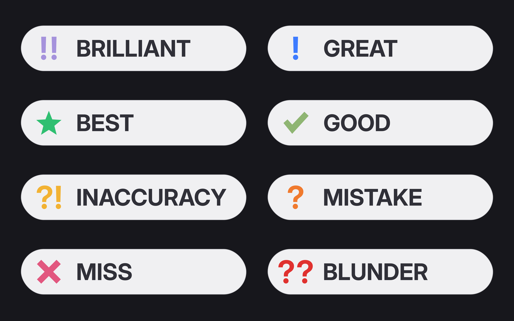

# Animated badge overlays — downloads

The rendered video files are in **[downloads/](downloads/)**. Each badge ZIP contains the actual ProRes 4444 `.mov`, its matching transparent `.png`, and its vector `.svg`. They are ready to import into Premiere Pro after unzipping. All clips are 15 seconds, 60 fps, 1,080 × 264 px, transparent at the start and end, and contain no audio.

| Badge | Download rendered video + PNG + SVG |
| --- | --- |
| BRILLIANT | [brilliant.zip](downloads/brilliant.zip) |
| GREAT | [great.zip](downloads/great.zip) |
| BEST | [best.zip](downloads/best.zip) |
| GOOD | [good.zip](downloads/good.zip) |
| INACCURACY | [inaccuracy.zip](downloads/inaccuracy.zip) |
| MISTAKE | [mistake.zip](downloads/mistake.zip) |
| MISS | [miss.zip](downloads/miss.zip) |
| BLUNDER | [blunder.zip](downloads/blunder.zip) |

Open an individual ZIP on GitHub and click **Download raw file** to download it. For everything together, click the green **Code** button → **Download ZIP** at the top of this repository. The complete repository ZIP includes all eight badge ZIPs and the editable source. Unzip the badge ZIPs to get the MOVs; no rendering is required.

[MP4 preview of all eight animations](badge_overlays/deliverables/preview/all_badges_dark.mp4) · [Render and customization instructions](badge_overlays/README.md) · [Editable settings](badge_overlays/source/settings.json) · [Python source](badge_overlays/source/render.py)



The full exported package is too large for GitHub's 100 MiB limit on a single repository file, so the rendered videos are delivered as eight ZIPs. This preserves the exact ProRes files without recompression. Each ZIP is below that limit.

To extract all badge ZIPs into the renderer's output folders at once, run this from the downloaded repository directory (Python standard library only):

```sh
python3 extract_downloads.py
```

The resulting MOVs appear in `badge_overlays/deliverables/mov/`. Matching PNGs and SVGs are already available in `badge_overlays/deliverables/`. In Premiere Pro, use **Straight — Unmatted** alpha interpretation if prompted.

All 200 export checks passed, including decoded alpha and fade timing, consistent positioning, stationary holds, no clipping, dimensions, frame count, duration and no audio. See [verification.json](badge_overlays/deliverables/quality/verification.json) for results.
